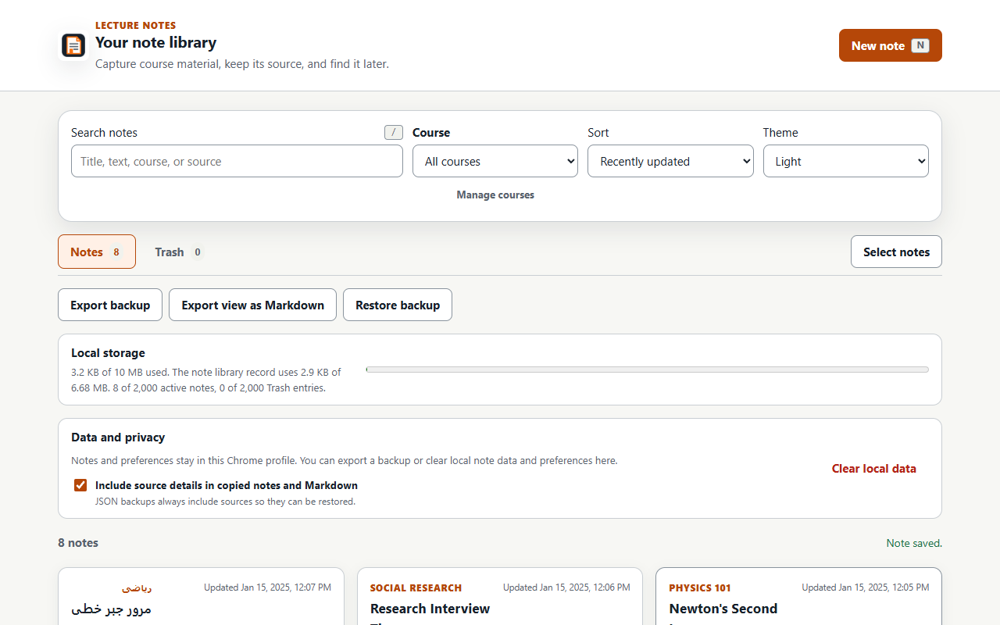
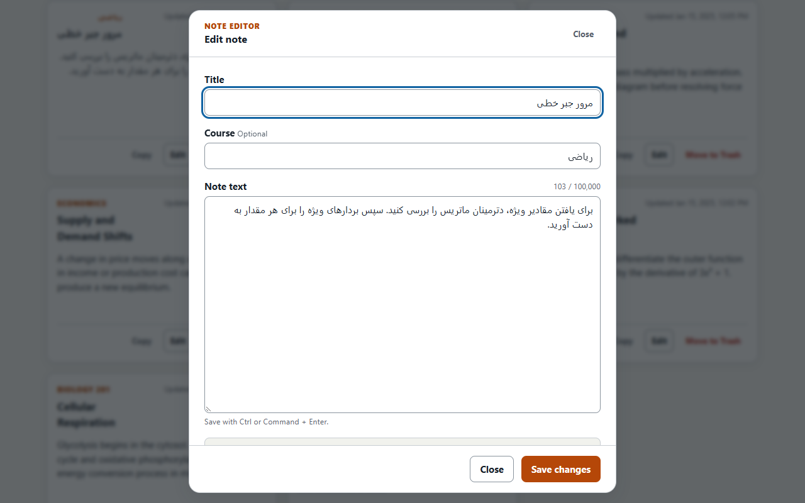

<p align="center">
  
</p>

<h1 align="center">Lecture Notes</h1>

<p align="center">
  Capture useful material from the web, keep its source, and build a searchable study library inside Chrome.
</p>

<p align="center">
  <strong>Manifest V3</strong> &nbsp;•&nbsp; <strong>Local-only data</strong> &nbsp;•&nbsp; <strong>No account</strong> &nbsp;•&nbsp; <strong>No network requests</strong>
</p>

<p align="center">
  <a href="#install-in-chrome">Install</a> ·
  <a href="#capture-notes">Capture notes</a> ·
  <a href="#permissions-and-privacy">Privacy</a> ·
  <a href="#development">Development</a> ·
  <a href="#current-limitations">Limitations</a>
</p>

<p align="center">
  
</p>

<p align="center"><sub>The note library keeps search, course filters, exports, storage status, and note actions in one view.</sub></p>

I built Lecture Notes because I wanted a quick way to save useful material from lecture pages without sending my notes to a remote service. The extension uses plain HTML, CSS, and JavaScript modules. It has no runtime dependencies, remote scripts, account system, or source build step.

## What it does

- Captures selected text from the toolbar, a keyboard shortcut, or the selection context menu, including focused embedded frames when Chrome allows access.
- Keeps a cleaned page title and HTTP or HTTPS source with each draft, while supporting manual notes on protected pages.
- Autosaves quick-capture and full-editor work, queues pending context-menu captures, and recovers unfinished drafts without replacing newer notes.
- Provides a searchable library with course filtering, sorting, course management, duplicate warnings, full-tab and side-panel views, and Persian and Arabic letter matching.
- Protects deleted work with persistent Trash and supports bulk course, export, Trash, restore, and permanent-delete actions.
- Exports restorable JSON backups or Markdown, lets copied text omit source details, and supports local data reset with an export-first option.
- Supports system, light, and dark themes, keyboard navigation, RTL content, and Unicode text.

Markdown is an export format. Notes are stored and edited as plain text.

## Install in Chrome

Chrome 116 or newer is required. The project does not currently have a published Chrome Web Store listing, so install the tested release package as an unpacked extension.

1. Open the [latest GitHub release](https://github.com/Imanm02/LectureNote-ChromeExtension/releases/latest).
2. Download `lecture-notes-<version>.zip` and its matching `.sha256` file. Compare the ZIP's SHA-256 value before extracting it.
3. Extract the ZIP into a folder you plan to keep.
4. Open `chrome://extensions` in Chrome.
5. Enable **Developer mode**.
6. Select **Load unpacked**.
7. Choose the extracted folder that contains `manifest.json`.
8. Pin **Lecture Notes** from Chrome's extensions menu if you want quick access.

Verify the downloaded ZIP and checksum from the folder that contains both files. Replace `X.Y.Z` with the release version:

```powershell
$archive = "lecture-notes-X.Y.Z.zip"
$expected = (Get-Content "$archive.sha256").Split()[0].ToLowerInvariant()
$actual = (Get-FileHash $archive -Algorithm SHA256).Hash.ToLowerInvariant()
if ($actual -ne $expected) { throw "Checksum mismatch" }
```

On macOS, run `shasum -a 256 -c lecture-notes-X.Y.Z.zip.sha256`. On Linux, run `sha256sum -c lecture-notes-X.Y.Z.zip.sha256`.

To install the current source instead, clone the repository and choose that folder in step 7:

   ```bash
   git clone https://github.com/Imanm02/LectureNote-ChromeExtension.git
   ```

Before updating an unpacked installation, export a JSON backup. Replace the files inside the same installed folder, then return to `chrome://extensions` and select **Reload** on the extension card. Loading the extension from a different folder can create a separate extension identity with separate local storage.

The first popup or library page shows the local-data disclosure before notes, drafts, page details, or selections are read. Choose **Allow local note capture** to continue. Closing the surface leaves the choice unaccepted. Existing extension data can be cleared from that disclosure without opening it first.

## Capture notes

1. Open Lecture Notes and accept the local-data disclosure if this is the first use after installation or a local-data reset.
2. Select text on a lecture page.
3. Open Lecture Notes from the toolbar, press the configured shortcut, or choose **Capture selection in Lecture Notes** from the selection context menu.
4. Review the captured title and text. Choose or enter an optional course, then save.
5. Open the library from the popup when you want to review or organize saved notes.

After saving, quick capture clears the note text but keeps the current page source and course ready for another note. If the title is blank, the first nonempty line of the note becomes its title.

Chrome blocks scripted page access on internal pages, the Chrome Web Store, and some other protected pages. Quick capture still opens there so a note can be entered manually.

For privacy, the selection context menu does not capture text from editable fields. Use the toolbar or keyboard shortcut for an ordinary text input. Password fields are never captured.

## Use the library

The library can open beside the current page in Chrome's side panel or in a full tab. It supports search, course filtering, sorting, note details, editing, and theme preferences.

<p align="center">
  
</p>

<p align="center"><sub>The full editor supports long notes, keyboard saving, Unicode text, and right-to-left writing.</sub></p>

Search text and a selected course remain visible in an active-filter bar, even when matches are present. Use **Clear filters** to return to the full view.

Use **Manage courses** beside the Course filter to change a label across the library. The dialog lists every course found in active notes or Trash with exact counts. Renaming changes every matching label. Entering an existing course merges the labels and keeps the target label's stored spelling. Clearing removes the label. These operations update active notes and Trash together; they never combine or delete notes. If another library tab changes a matching record before confirmation, the older operation is refused instead of overwriting it.

Selection mode provides grouped actions:

- Active notes can receive or clear one course, export to Markdown, or move to Trash.
- Trash entries can be restored or permanently deleted after confirmation.

Moving a note to Trash does not erase it. Restore puts it back in the active library. Permanent delete and Empty Trash cannot be undone.

Closing the full editor keeps changed fields as a local recovery draft. The library shows that draft without opening it automatically. If the original note changed or was deleted, recovery creates a new note rather than overwriting newer library data.

## Back up, share, and clear data

JSON backup is the restorable format. It includes active notes, Trash, sources, and settings. The restore preview shows how Merge and Replace will affect the library. Merge preserves separately saved copies and skips a backup note only when its ID, text, course, and source URL match an existing record. Replace removes the current library after confirmation.

Markdown export follows the current search, course filter, and sort order. Selection mode can export only the chosen active notes. The **Include source details in copied notes and Markdown** setting controls source details in copied text and Markdown files. JSON backups always include sources so they can restore the full record.

Unfinished drafts and pending captures are recovery data, not saved notes, so they are not included in JSON or Markdown exports.

Use **Clear local data** in the library only when you want a fresh extension state. The confirmation shows exact active-note and Trash counts, offers **Export backup first**, and requires the word `DELETE`. It removes notes, Trash, popup and editor drafts, pending captures, recovery notices, help and onboarding state, the first-use consent choice, and preferences. Downloaded backup or Markdown files remain on the device because they are outside extension storage.

### Keyboard shortcuts

| Context | Shortcut | Action |
| --- | --- | --- |
| Chrome on Windows or Linux | `Ctrl+Shift+Y` | Open quick capture |
| Chrome on macOS | `Command+Shift+Y` | Open quick capture |
| Popup or note editor | `Ctrl+Enter` or `Command+Enter` | Save the note |
| Library | `/` | Focus search |
| Library | `N` | Create a note |

Chrome may decline the suggested capture shortcut if another extension already uses it. Review or change extension shortcuts at `chrome://extensions/shortcuts`.

## Permissions and privacy

| Permission | Why it is needed |
| --- | --- |
| `activeTab` | Grants temporary page access after a toolbar or keyboard capture action |
| `contextMenus` | Adds one selection command for sending page selections to quick capture while refusing editable fields |
| `scripting` | Runs the packaged selection reader in the active tab and focused frame |
| `sidePanel` | Opens the note library beside the current page |
| `storage` | Saves notes, Trash, settings, the first-use consent choice, drafts, pending captures, and recovery records in `chrome.storage.local` |

The extension has no host permissions, persistent content scripts, external messaging, or web-accessible resources. It makes no network requests. Notes remain in the current Chrome profile and do not use Chrome Sync.

The first-use disclosure names the page and note data the extension can handle, states why local storage is used, and requires an affirmative choice. The selection context menu is unavailable until that choice is saved. Clearing local data removes the choice and shows the disclosure again.

Saved source URLs accept only HTTP or HTTPS. URL credentials, fragments, known authentication parameters, and tracking parameters are removed before storage. Other paths and query parameters can still contain private information, so review a source before saving or sharing it.

Stored data and exported files are not encrypted. Anyone with access to the Chrome profile or an exported file may be able to read them. The full data-handling statement is in the [Privacy Policy](PRIVACY.md).

Export a JSON backup before uninstalling the extension, clearing its local data, or removing the Chrome profile. Uninstalling removes the extension's local storage. A later installation does not restore it automatically.

## Development

Install Node.js 24.15 or newer in the Node 24 line, or Node.js 26 or newer. npm 11.12.1 or newer in the npm 11 line is required. Then install the locked development dependencies:

```bash
npm ci
```

Run the usual local validation suite:

```bash
npm run validate
```

Install Playwright's Chromium build once before browser testing:

```bash
npx playwright install chromium
npm run test:browser
```

On a new Debian or Ubuntu test host, `npx playwright install --with-deps chromium` also installs the required system packages.

The stable Chrome action test also requires a current Chrome installation. It uses a new temporary profile, loads the unpacked extension through Chrome DevTools Protocol, and removes the profile afterward. It never opens the regular Chrome profile.

Available checks:

| Command | Purpose |
| --- | --- |
| `npm run lint` | Check source, tests, and scripts with ESLint |
| `npm test` | Run Node unit, integration, and DOM tests |
| `npm run test:coverage` | Run tests with the committed coverage floors |
| `npm run check:extension` | Validate the manifest, permissions, packaged resources, syntax, unsafe sinks, network calls, and credential patterns |
| `npm run validate` | Run lint, tests, and extension validation |
| `npm run preflight` | Run the audit, lint, coverage, and extension checks before browser testing |
| `npm run test:browser` | Load the source extension in Playwright Chromium and exercise its main flows |
| `npm run test:browser:chrome` | Trigger the real toolbar action in stable Chrome and verify focused-frame capture and storage |
| `npm run package:extension` | Create the release ZIP and SHA-256 checksum in `dist/` |
| `npm run check:package` | Inspect the ZIP allowlist and validate the packaged extension |
| `npm run test:browser:package` | Extract the release ZIP and smoke-test the packaged extension |
| `npm run test:browser:chrome:package` | Extract the ZIP and test its toolbar action in stable Chrome |
| `npm run store:screenshots` | Build the exact ZIP and create four 1280 by 800 Store screenshots from it |
| `npm run release:check` | Run the local release gate against the source and package in Chromium and stable Chrome |

The release gate creates `dist/lecture-notes-<version>.zip` and its SHA-256 file. The generated `dist/` directory is not committed. This repository does not use GitHub Actions, so release checks run on a trusted local machine. The Chromium run exercises the wider product flow. The stable Chrome run triggers the real toolbar popup, captures a selection from a focused embedded frame, saves it, and checks local storage for both the source and extracted package.

Store artwork is committed, so it is present after a fresh clone. To regenerate the icons and promotional image, install the pinned Pillow release and run the asset scripts:

```bash
python -m pip install --requirement requirements-artwork.txt
python scripts/generate_icons.py
node scripts/render_store_assets.mjs
```

Run `npm run store:screenshots` to rebuild the four Store screenshots from the packaged extension. Review every changed image before committing it.

## Data limits

| Item | Limit |
| --- | ---: |
| Title | 160 characters |
| Course | 80 characters |
| Note body | 100,000 characters |
| Source title | 200 characters |
| Source URL | 2,048 characters |
| Active notes | 2,000 |
| Trash entries | 2,000 |
| Pending context-menu captures | 10 |
| Total extension local storage | 10,485,760 bytes |
| Note-library state record | 7,000,000 bytes |
| Quick-capture recovery draft | 425,000 bytes |
| Full-editor recovery draft | 1,500,000 bytes |
| Pending-capture queue | 750,000 bytes |
| Backup import or export | 8,000,000 bytes |
| Initial library display batch | 100 notes |

The total storage limit covers every extension record, not only saved notes. The library meter reports total local use and the note-library record separately. A byte limit can be reached before its item-count limit when content is large.

## Troubleshooting

- If capture is empty on a protected page, type the note manually. Chrome does not allow selection injection there.
- If the shortcut does not open quick capture, check `chrome://extensions/shortcuts` for a conflict.
- After pulling source changes, select **Reload** on the extension card at `chrome://extensions`.
- Loading the unpacked extension from another folder may create a different extension identity with separate local storage. Load the original folder or restore a JSON backup.
- If a backup is rejected, confirm it is an unedited Lecture Notes JSON backup within the documented size limit and from a supported schema version.
- For a repeatable problem, use the [bug report form](https://github.com/Imanm02/LectureNote-ChromeExtension/issues/new?template=bug_report.yml). Remove private note text and URLs before posting.

## Current limitations

- Chrome blocks selection injection on protected pages. Manual note entry still works.
- Notes belong to one Chrome profile. There is no account sync, cloud backup, or collaboration.
- Stored data and exported files are not encrypted.
- Undo covers the latest move to Trash for the current library session. Trash itself persists until entries are restored, permanently deleted, or cleared.
- Chrome versions older than 116 and other browsers are not supported.

## Project structure

| Path | Purpose |
| --- | --- |
| `manifest.json` | Manifest V3 registration, five permissions, popup, shortcut, side panel, and worker |
| `popup.html`, `popup.css`, `src/popup.js` | Quick capture and draft recovery |
| `notes.html`, `notes.css`, `src/notes.js` | Library, Trash, bulk actions, settings, and note editor |
| `src/model.js` | Validation, normalization, note operations, and limits |
| `src/storage.js` | Local persistence, migration, locking, reset handling, and recovery |
| `src/capture.js` | Active-page and focused-frame selection capture |
| `src/backup.js` | JSON backup restore and Markdown export |
| `src/background.js` | Context menu, side panel, pending captures, and internal draft handoff |
| `tests/` | Model, storage, UI, capture, worker, and regression tests |
| `scripts/` | Validation, browser smoke testing, packaging, and store-asset generation |
| `store-assets/` | Chrome Web Store promotional artwork and generated package screenshots |

## Releases and security

Run `npm run release:check`, follow the [local release checklist](docs/RELEASE_CHECKLIST.md), and record user-facing changes in [CHANGELOG.md](CHANGELOG.md). The [store listing guide](docs/STORE_LISTING.md) keeps submission text and privacy answers beside the code.

Report suspected vulnerabilities using [SECURITY.md](SECURITY.md). Do not post exploit details, credentials, backups, or private notes in a public issue.

## License

This project is available under the [MIT License](LICENSE).
